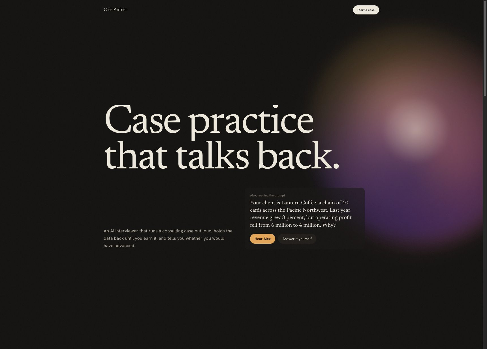
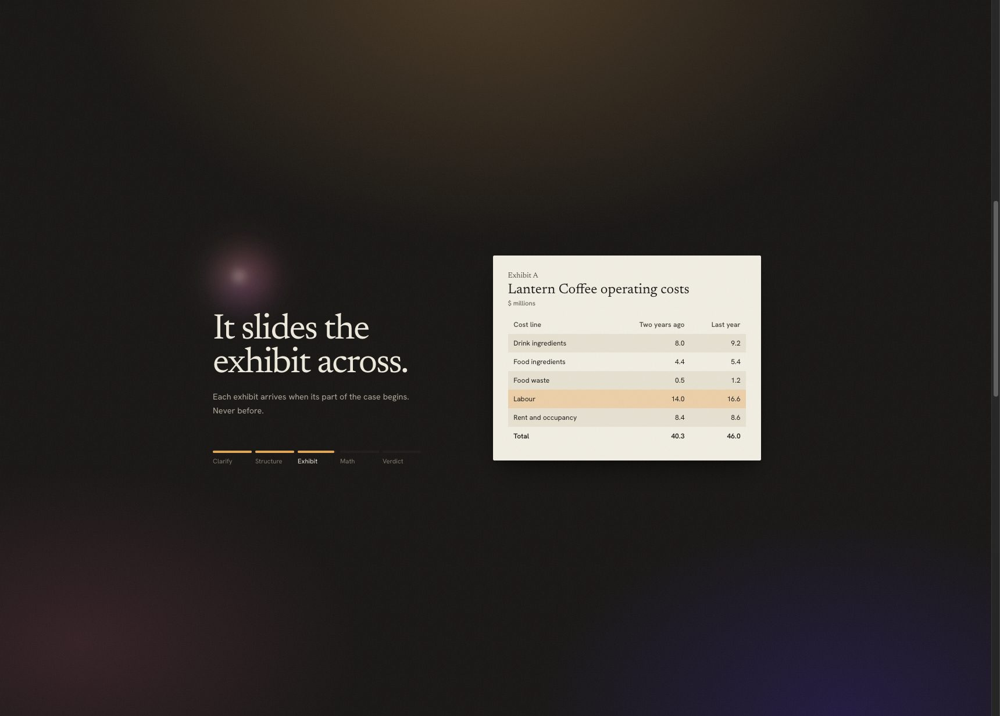
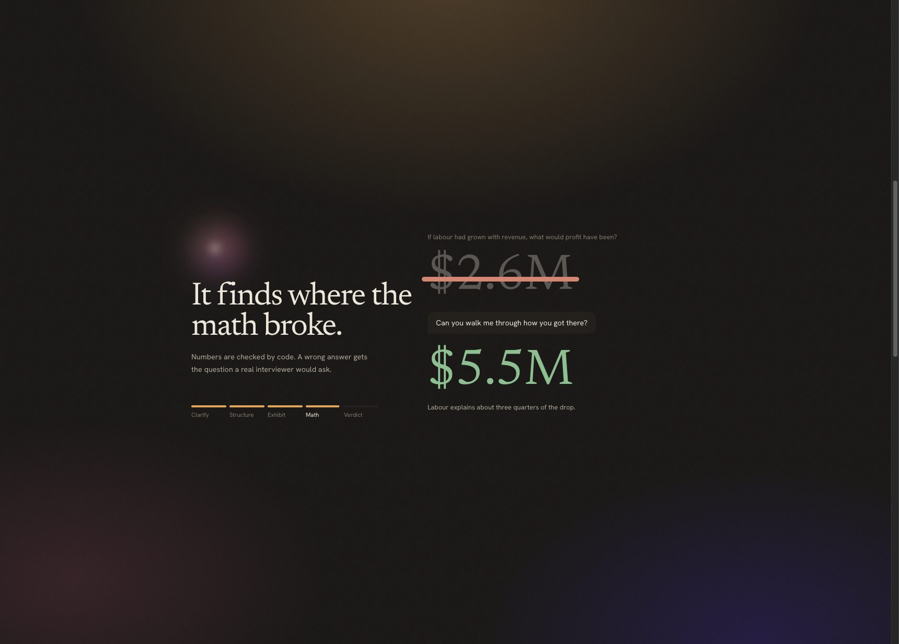
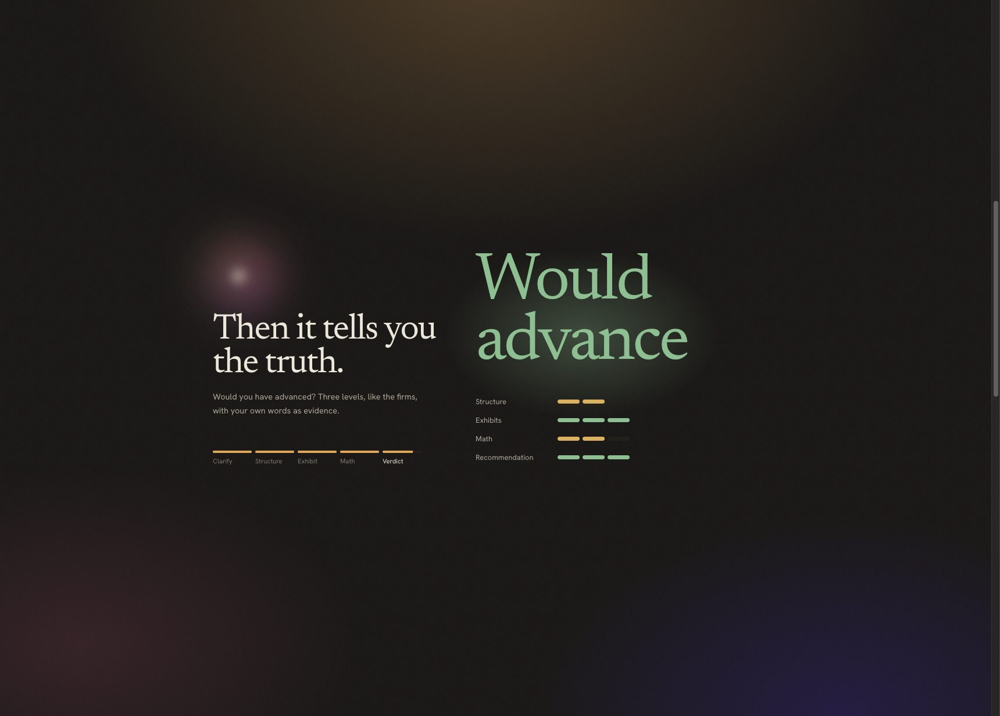
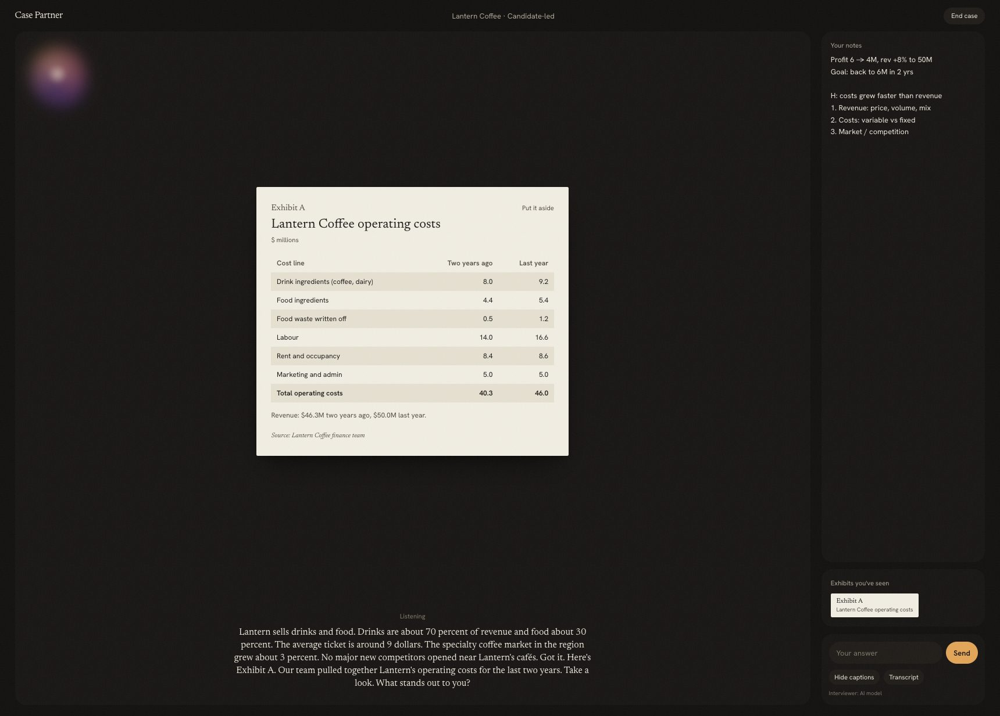
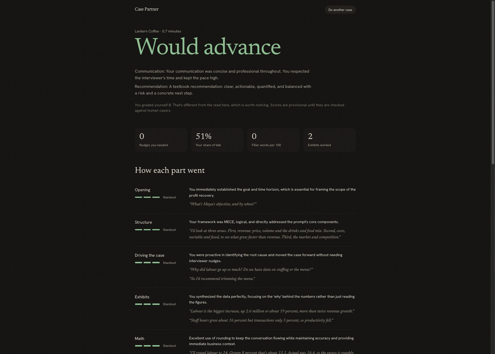
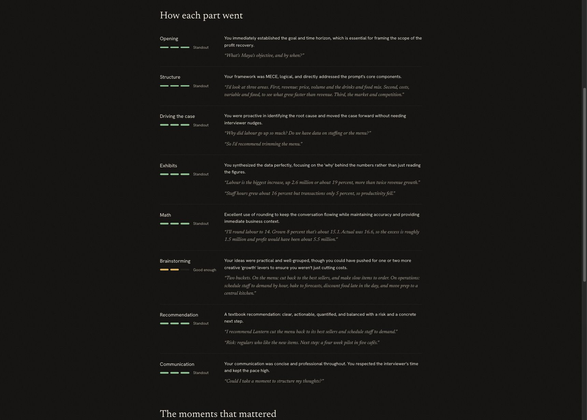

# Case Partner

**An AI interviewer for consulting case practice.** It runs a case out loud the way a second-year does: it reads you the prompt, holds the data back until you ask for it, puts each exhibit on the table when its part of the case begins, probes your math, and ends by telling you whether you would have advanced, with quotes from your own case as evidence.

Upload your own casebook PDF, pick the case, and practise it any time you can't find a case partner.

> **Status: in progress.** It works end to end, but it is not finished. The interviewer still reads too much like a script and too little like a person. The next version rebuilds it as a conversation that reacts to what you say. See [What's next](#whats-next).



## What it looks like

**The landing page plays a case on its own**: the data held back, the silence while you structure, the exhibit sliding across, a wrong number caught, and the verdict.

| | |
|---|---|
|  |  |



**The case room.** The interviewer is a light that reacts to its voice. Exhibits arrive as paper when you earn them and stay in a tray you can reopen. There is a notepad and no calculator, like the real thing.



**The debrief.** You grade yourself first. Then the verdict, the two things that decided it, and each part of the case graded on three levels the way consulting firms rate, with your own words quoted as evidence.

| | |
|---|---|
|  |  |

## How it works

**Two minds.** A hidden director reads the whole answer key and decides what you have earned: which fact, which exhibit, whether your method is sound, whether to nudge. The voice you talk to only ever knows what has been unlocked. Code enforces the reveal rules either way, so a model that wants to be helpful cannot hand you the answer.

**Your casebook, your browser.** The PDF is read in your browser. Only the pages of the case you choose are sent to the model to set it up, and the result is saved in your browser, not on a server. Books whose terms forbid use with AI tools are refused on upload.

**Numbers are checked by code.** Sensible rounding passes, a right method with a slipped number is acknowledged, and a 10x error is caught as its own mistake.

**Tested against the real thing.** 59 tests cover leaks, exhibit timing, math judging and casebook reading. Live runs against the real model on real casebook cases found most of the bugs fixed so far; each is logged with its fix in [evals/FINDINGS.md](evals/FINDINGS.md).

## Stack

Next.js, TypeScript, Tailwind, GSAP. Gemini for the director, the voice and the debrief (free tier), with browser speech recognition and a browser voice as fallbacks. pdf.js for reading casebooks in the browser. Vitest.

## Run it

```bash
npm install
cp .env.example .env.local   # add a free Gemini key from https://aistudio.google.com/apikey
npm run dev                  # http://localhost:3000; Chrome or Edge for voice
npm test
```

## What's next

- **A conversation, not a script.** Rebuild the interviewer so every line reacts to what you just said: push back on good answers too, bring in new information mid-case, follow your path when it can answer the question, and behave like a McKinsey or BCG interviewer depending on the format.
- **Bring your own key.** Each user pastes a free Gemini key, kept in their browser for their session only.
- **A free voice that runs in the browser** (Kokoro), with backup model providers so a busy free tier never stalls a case.
- **Calibration.** Compare its scores with second-years' on the same sessions. Until then, every score is marked provisional.

Design notes live in [docs/](docs/): the plan, the interviewer, the case format, the evals and the design.
